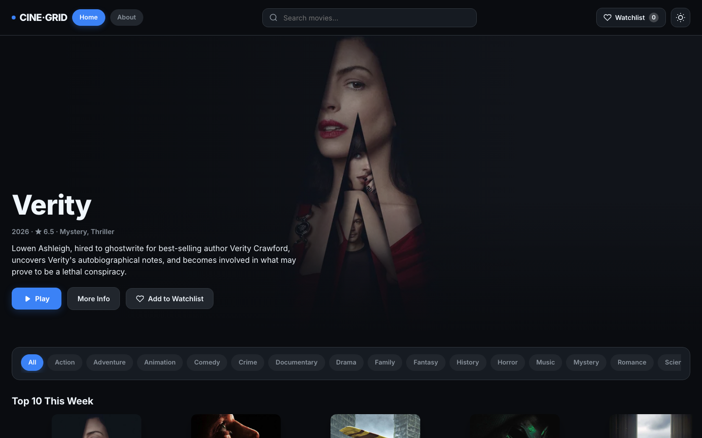

# CineGrid

A movie browser built with React and TypeScript on the TMDB API, with a full-page player that streams video the way Netflix does.



---

## Features

- **Browse rows:** Home opens on a featured movie, then horizontal rows such as Trending, Top Rated and Coming Soon. A title appears once on the page, even when TMDB lists it several times.
- **Popular movies, endlessly:** below the rows, a grid fetches the next page as you scroll near the bottom.
- **Genres:** the genre pills swap the rows for one genre, sorted by popularity, rating, date or title. The genre is in the URL (`/?genre=35`).
- **Search:** searches all of TMDB as you type, from any page.
- **Title pages:** every movie has its own link, `/movies/:id`, with the runtime, age rating, director, cast, trailer and similar movies. Inside the app it opens over the current page; opened directly, it's a full page.
- **Watchlist:** the heart saves a movie to the `/watchlist` page and a row on Home. It's kept between visits.
- **Continue Watching:** the player remembers where you stopped. Unfinished movies get a row on Home and a progress bar, Play becomes Resume, and a "More Like" row follows the last one you watched.
- **Light and dark themes**, also kept between visits.
- **Streaming player:** `/watch/:id` plays the video on a full page and starts by itself. A back arrow, the title and the current quality sit at the top; the seek bar, ±10 s, volume, speed, picture-in-picture and fullscreen sit at the bottom. The controls hide when the mouse is idle.
- **Pause screen:** pausing for two seconds dims the video and shows the movie's details.
- **Up Next:** at the end of a movie, a 10-second countdown starts a similar one.
- **Keeps your place:** closing a title or leaving the player returns to the same spot on the page, with nothing reloaded.

---

## Tech stack

| Tool | Purpose |
|---|---|
| React 18 + TypeScript | UI and static typing |
| Vite | Dev server and build |
| React Router | Pages: Home, About, Movie, Watch, Watchlist, 404 |
| Context API + `useReducer` | Theme, favourites and watch progress, saved to `localStorage` |
| hls.js | HLS video playback |
| Media Chrome | Player controls |
| Vitest + Testing Library | Tests |
| TMDB API v3 | Movie data and images |

---

## Getting started

**Prerequisites:** Node.js 20 or newer and a free [TMDB account](https://www.themoviedb.org/signup).

**1. Install dependencies**
```bash
npm install
```

**2. Add your TMDB token**
```bash
cp .env.example .env
```
Open `.env` and set `TMDB_API_KEY` to your **API Read Access Token**: the long token under TMDB Settings → API, not the short API key. Keep that name: anything starting with `VITE_` is built into the public JavaScript.

**3. Start the dev server**
```bash
npm run dev
```

The app runs at http://localhost:5173.

---

## Scripts

```bash
npm run dev              # Start the dev server
npm run build            # Type-check and build for production
npm run preview          # Serve the production build
npm run lint             # Run ESLint
npm run type-check       # TypeScript check
npm run test             # Tests in watch mode
npm run test:run         # Run all tests once
npm run test:m2          # Milestone 2 suite
npm run test:m3          # Milestone 3 suite
npm run test:features    # Rows, title pages, search, watchlist, resume, API route
```

The milestone 1 suite (`npm run test:m1`) was written before favourites moved into the global context in Session 5, so it no longer passes. The milestone 2, milestone 3 and features suites pass.

---

## How the streaming works

TMDB doesn't host films, so every movie plays the same demo video. The point is to show how streaming services deliver video: **adaptive bitrate streaming over HLS**.

- The player first loads a master playlist (`.m3u8`) that lists the same video at five qualities, from 240p to 1080p.
- Each quality is cut into segments of about 10 seconds. The player downloads a few at a time, so playback starts quickly and seeking only fetches the segments near the new position.
- hls.js measures the download speed and switches to the quality the connection can handle.

**See it happen:** open DevTools → Network and press Play on any movie. You'll see the master playlist, then one quality's playlist, then its `.ts` segments. The quality is in each segment's file name (`ld` 240p, `hq` 480p, `hd` 720p, `fhd` 1080p). Throttle the network to "Slow 4G" and the new segments switch to a lower quality.

---

## Deploying

The app is set up for [Vercel](https://vercel.com). The browser never talks to TMDB directly: it calls `/api/tmdb`, a Vercel Function that adds the token on the server and only allows the endpoints the app uses.

1. Import the repository into Vercel. It detects Vite, so the build settings can stay as they are.
2. Add `TMDB_API_KEY` under Environment Variables as a **Secret**.
3. To deploy a branch other than `main`, change it under Settings → Environments → Production → Branch Tracking.

In `npm run dev` and `npm run preview`, a proxy in `vite.config.ts` does the same job, because Functions only run on Vercel. It has no endpoint allow-list, and it's never deployed.

---

## Project structure

```
api/                # tmdb.js: the Vercel Function that holds the TMDB token
src/
├── components/     # header, Billboard, MovieRow, InfiniteGrid, MovieCard, MovieInfo, MovieModal, StreamPlayer, ...
├── context/        # AppContext: theme, favourites and watch progress (useReducer + localStorage)
├── data/           # TMDB fetch helper, genre map, image URL helpers, sample movies
├── hooks/          # useMovies (paged, appends results), useBrowseRows, useMovieDetails, useGenres, ...
├── pages/          # HomePage, AboutPage, MoviePage, WatchPage, WatchlistPage, NotFoundPage
├── test/           # milestone and feature test suites
├── App.tsx         # routes, including the overlay routes for titles and the player
└── index.css       # all styles, with light/dark theme variables
vanilaVersion/      # the original plain-JavaScript version the React app was ported from
```

---

## Known limitations

- Every movie plays the same demo video, so Continue Watching tracks each title separately but the picture is always Big Buck Bunny.
- Opening `/watch/:id` directly (new tab, shared link) may wait for a press of Play, because browsers can block video that starts by itself.
- The watchlist and watch progress live in the browser's `localStorage`, so they don't follow you to another device.
- On iPhones, fullscreen switches to the system player, so the custom controls don't show there.

---

## Credits

- Movie data and images come from [TMDB](https://www.themoviedb.org). This product uses the TMDB API but is not endorsed or certified by TMDB.
- The demo video is [Big Buck Bunny](https://peach.blender.org), © 2008 Blender Foundation, licensed under [CC BY 3.0](https://creativecommons.org/licenses/by/3.0/). The stream is one of Mux's public test streams.

---

## Course

Built for **Front-End Frameworks** (2627_BSI_CS_S05_PROG_FEF), EPITA Bachelor in Computer Science, S5. Each session has its own branch (`01` to `04`).

Milestones are submitted by pushing a tag. The tag starts a GitHub Actions workflow that runs the tests and reports the result to the course sheet. The workflow needs the `SHEETS_WEBHOOK_URL` repository secret (Settings → Secrets and variables → Actions), provided by the teacher.

| Milestone | Tag |
|---|---|
| 1: Props, State, and useState | `milestone-1` |
| 2: Routing and SPA Architecture | `milestone-2` |
| 3: Global State with Context API | `milestone-3` |

```bash
git tag milestone-3
git push origin milestone-3
```

Tags are unique. To resubmit, delete the old tag first:
```bash
git tag -d milestone-3
git push origin --delete milestone-3
git tag milestone-3 && git push origin milestone-3
```
